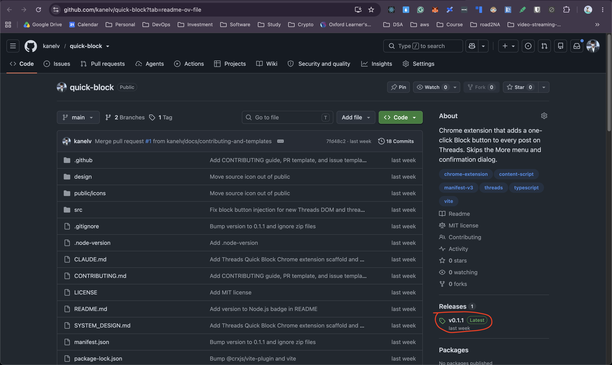
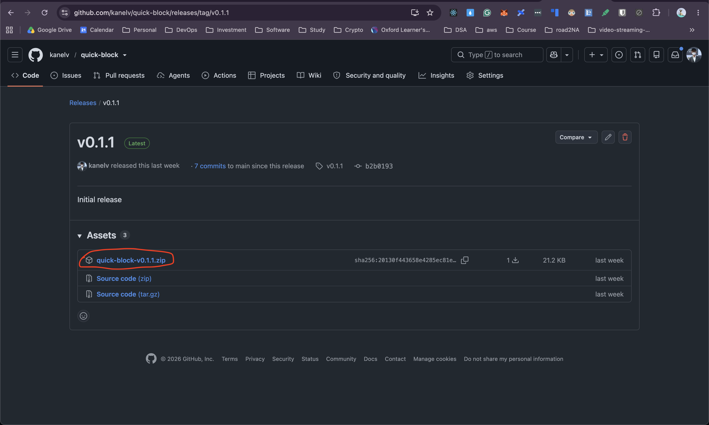
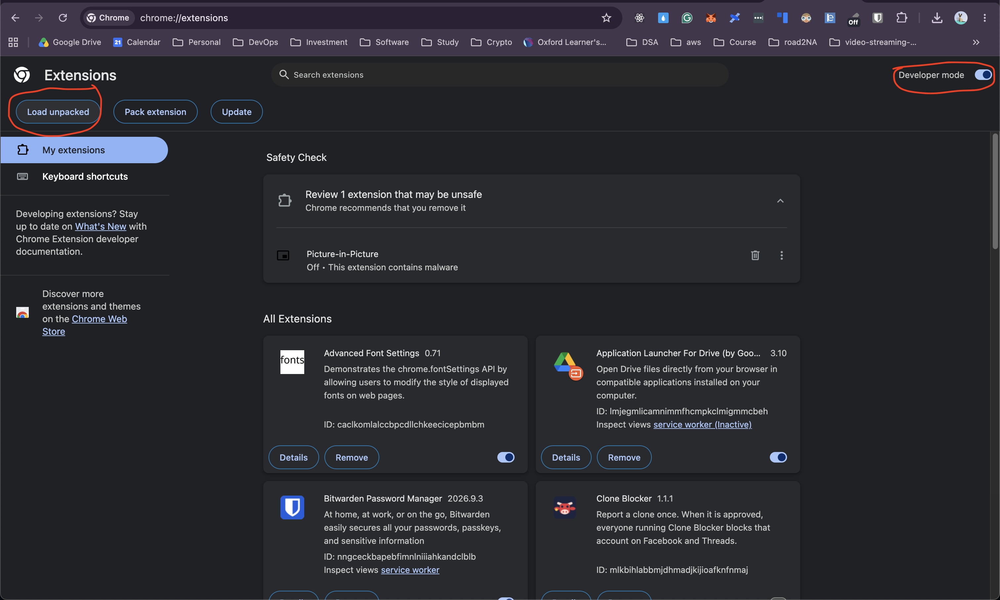
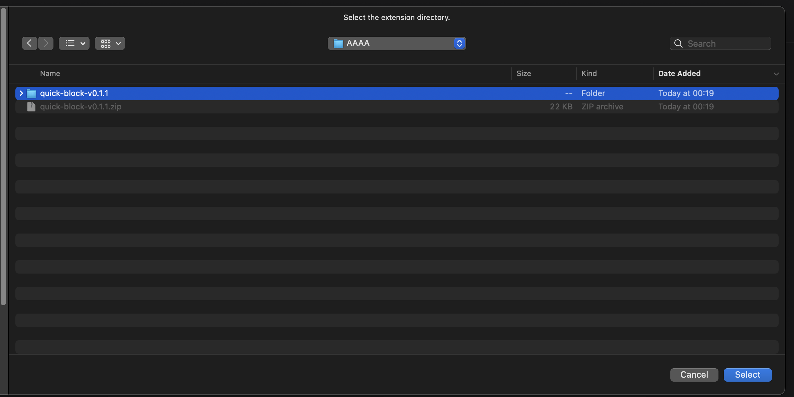
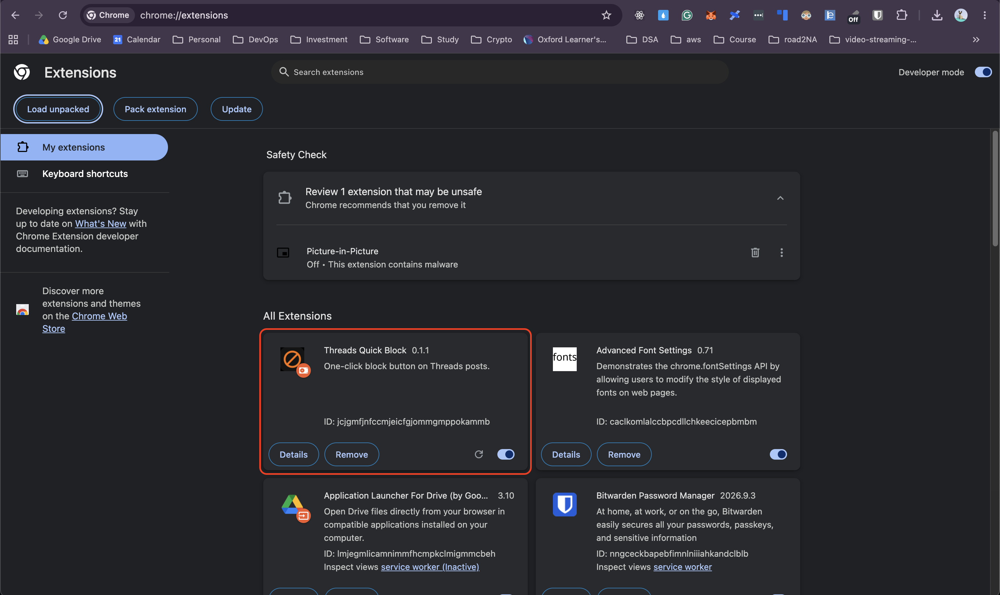
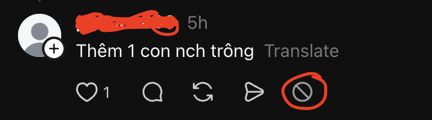

# Manual Instruction

Install Threads Quick Block in Chrome. Pick one option.

## Option A: From a release (no build)

1. Open the [Releases page](https://github.com/kanelv/quick-block/releases) and download `quick-block-vX.Y.Z.zip`.

   
   

2. Unzip it. Keep the folder; Chrome loads the extension from it.
3. Open `chrome://extensions`.
4. Turn on **Developer mode** (top right).
5. Click **Load unpacked** and select the unzipped folder (the one containing `manifest.json`).

   
   

6. Confirm "Threads Quick Block" appears and is enabled.

   

7. Result on Threads: each post shows the block button in its action row.

   

## Option B: From source

Requires Node.js 24.21.0 (see `.node-version`) and git.

```bash
git clone https://github.com/kanelv/quick-block.git
cd quick-block
npm install
npm run build
```

Then follow steps 3-6 above, selecting the `dist/` folder.

## Use

1. Open https://www.threads.net and log in.
2. Click the block button in a post's action row (next to like/reply/repost/share).
3. The account is blocked immediately, with no extra prompt.

## Update

- Release: download the new zip, replace the folder, click the reload icon on the extension card in `chrome://extensions`.
- Source: `git pull && npm install && npm run build`, then reload the extension.
- Refresh open Threads tabs after reloading.

## Troubleshooting

- No button appears: refresh the Threads tab; confirm the extension is enabled.
- Block fails: open DevTools console and filter for `[tqb]`. Threads' page structure may have changed.
